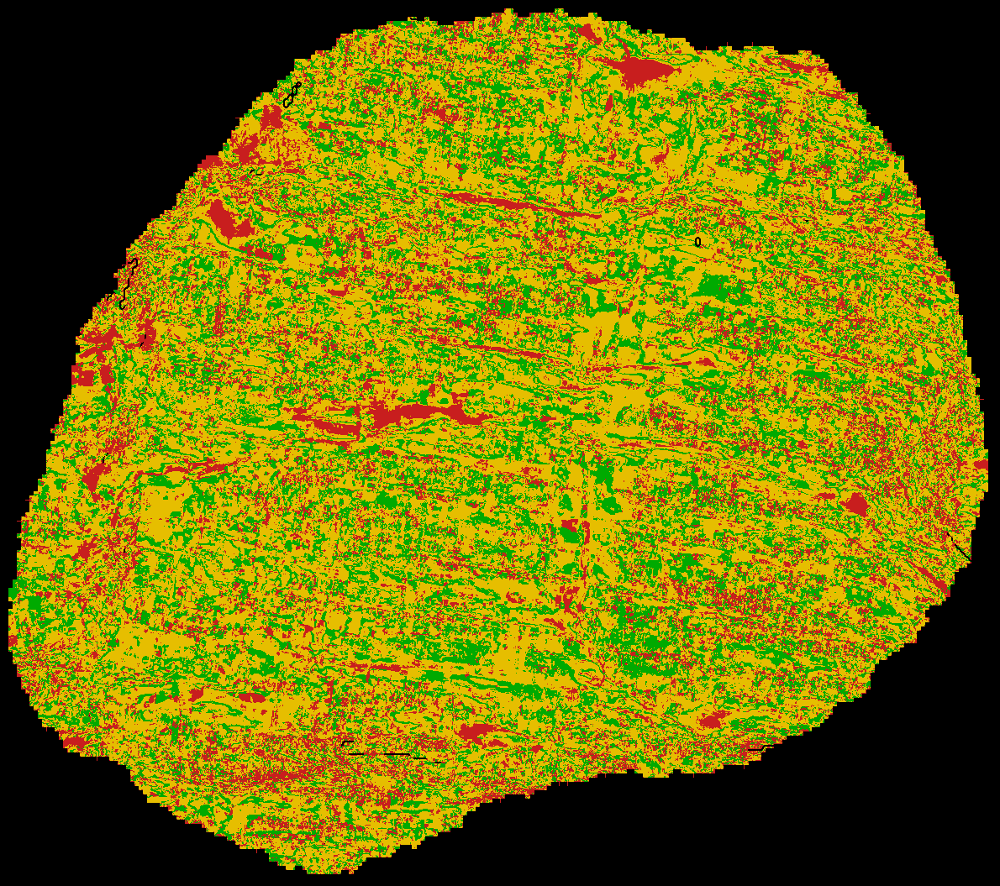

# Scan readability checks for the Vesuvius Challenge

Massimo Cocuzza, October 2026. Report: [REPORT.md](REPORT.md). Code MIT.

Three checks to run on a 9 µm scan before searching it for ink, validated on the eligible scrolls:

- **Sheet check.** Does this segment sit on one papyrus sheet? `readability.tifxyz` renders a 41-layer band around an organisers' tifxyz segment straight from the scan volume; `readability.sheets` maps, pixel by pixel, where the segment follows a distinct sheet. The organisers' August guide asks for this check by eye.
- **Clutter index.** How much fine texture will hide ink in this render? A label-free number (the share of near-surface variance in a band of periods around 75 µm) that predicts, for injected ink, how readable a render is.
- **Readability bench.** How faint can real ink be before my model misses it here? Real letters are blended at reduced contrast into a background render and read by any ink_9um-format model; the result is AUC against contrast, with bootstrap intervals.



*Sheet check of the official PHerc. 0841 w00 segment (quarter size). Green: a distinct sheet centred within ±2 layers of the mesh; yellow: a distinct sheet further from the mesh (normal when the mesh follows a sheet face); red: papyrus without a distinct sheet; grey: not checked.*

## What the checks found on real scroll data

- **Our own search was on the wrong surfaces.** On our PHerc. 0268 surfaces the sheet check found a distinct sheet on only 14% of the papyrus (63% on PHerc. 800), so our 261 cm² search of 0268 said little. The report demotes it accordingly.
- **Official segments differ.** The six official auto-grown PHerc. 800 segments range from 45% to 79% valid sheet (67% in all); the lowest share coincides with the lowest depth contrast, so read the two together. The three official PHerc. 0841 segments give 82-83%.
- **The standard ink render is too thin for the check.** On the same segments the 28- or 31-layer official surface volumes give 8-10 points less than a 41-layer band, because sheets near the edge of the band cannot close.
- **A campaign gap was partly our renders.** The first difference we measured between the 2025 scan campaigns shrank once the renders were matched (round 25).
- **A reconstruction setting alone moves a scan-quality index by 2×.** Two re-retrievals of the same PHerc. 0139 acquisition (pag0 and pag50, settings inferred from the volume names) double the clutter index and cost the readers 0.05-0.08 AUC (models trained on the original reconstruction). Scan-quality indices and campaign comparisons therefore depend on retrieval parameters that are not published (round 30).
- **An existing scan-quality index does not rank these renders.** gp13's structural SNR shows no relation to injected readability in our data (ρ −0.36 to −0.53 over 12 scrolls, p 0.08-0.24; −0.20 to +0.23 within the 113 keV campaign).
- **False lights.** At the threshold that finds half the letters, Reader v2 lights 14.6% of blank papyrus and Reader V3 7.5%.

## Measurements

- **Detection limit, for the models tested.** Reader v2 and Reader V3 (Domenico Russo) reach AUC 0.65 at 74-76% of PHerc. 1447's ink contrast; the limit spreads from 0.74 to 0.94 across five public models. No change we tried gained 0.03 AUC, though four intervals still include that bar. The ideal linear observer (a Hotelling discriminant on patches up to 21 px, cross-fitted by winding) is at chance on the same bench: no linear template of that size sees the ink, so the networks are not leaving linear evidence behind.
- **Readability follows render texture, for 1447-type ink.** With PHerc. 1447 letters the clutter index predicts injected-ink readability: Spearman −0.75 to −0.97 in every variant on native renders, including within one campaign; on voxel-resampled renders it does not rank (−0.18 and −0.12). With PHerc. 0841 letters the relation is weaker and depends on the crop window (−0.35 to −0.85). The information sits at periods of about 55-120 µm; plain gradient energy does about as well, total variance does not. Validated on injected ink only; the index describes the released render, not the papyrus as such.
- **Campaigns.** With matched renders the 9.362 µm / 113 keV campaign reads worse by +0.01 to +0.05 AUC, depending on the letter source and crop window. Resampling the backgrounds by the 8% voxel difference (two scrolls, band-limited) moves readability by up to 0.06, so the gap cannot be put down to the campaign's papyrus texture.
- **Noise.** Noise is about 1% of the papyrus variance at periods of 26-130 µm and 6-18% in the finest band (σ 1-3 px, where the clutter index is measured). Doubling it costs 0.014 AUC; denoising does not help; deconvolution at the measured PSF does not raise AUC (round 31).
- **Label-free anomaly detection sees nothing.** A one-class detector of each scroll's own blank papyrus texture, which finds a +1 SD synthetic bump at AUC 0.998, ranks real letters at 0.51 at every contrast; what deviates from typical papyrus is material, not ink (round 33).
- **Finer voxels, measured once.** The same PHerc. 0841 letters in the same blank papyrus, read at 2.403 µm by the organisers' canonical 2 µm model and at 9.366 µm by Reader V3: AUC 0.65 at 55% of the letters' contrast against 77%, about 0.7× the 9 µm threshold; six letter units, so a wide interval (round 32).
- **Clutter spectrum.** The ink maps' clutter falls as f^−4, so statistics aggregated over letters, lines or columns lose one to two orders of magnitude of d′ against a stroke-scale detector (round 29).
- **Searches.** No candidate in 200 cm² of PHerc. 800 or 261 cm² of PHerc. 0268.

Every test had a pass/kill rule written before its computation: 33 rounds between 12 and 30 October 2026, in [docs/PREREGISTRATION_LOG.md](docs/PREREGISTRATION_LOG.md) (a dated file in this repository, not externally timestamped). Amended rules and post-hoc analyses are flagged in the report.

## Glossary

- **AUC:** pixel-level area under the ROC curve, labelled ink pixels against other papyrus pixels; 0.5 is chance.
- **α:** the contrast of the injected letters relative to their source render (1 = as scanned). **α₀.₆₅** is the α at which AUC falls to 0.65.
- **d′:** detectability index, √2 times the normal quantile of the AUC.
- **Clutter index:** share of near-surface papyrus variance in a difference-of-Gaussians band (σ 1 and 3 px, period about 75 µm at 9 µm voxels). Lower is quieter.
- **Render / surface volume:** the CT sampled layer by layer along the normal of a segment; "mesh layer" is the layer that contains the segment.
- **Lights / false lights:** pixels above a model's threshold; false lights are those on ink-free papyrus.
- **Winding:** one turn of the scroll; our own renders are per winding.
- **Campaigns:** the May 2025 ESRF scans (8.64 µm, 116 keV) and the July 2025 scans (9.362 µm, 113 keV).
- **T1 / T1b:** the main bench (PHerc. 1447 letters in PHerc. 800 papyrus) and the same letters in other 800 windings.
- **GB10:** the NVIDIA GB10 workstation (128 GB unified memory) on which every number was computed.

## Tools

| module | what it does | typical cost |
| --- | --- | --- |
| `readability.tifxyz` | renders a band (default 41 layers) around a tifxyz segment from a local zarr volume or the open-data URL, fetching only the chunks the band touches | minutes per segment; about 1.4 GB of chunks per 0841 segment, 1.1 GB for the six 800 segments together |
| `readability.sheets` | sheet check: share of papyrus with a distinct tracked sheet, centring on the mesh, depth contrast; optional quarter-size map (`--map`) and full-resolution class mask aligned to the render (`--mask`) | about 1 min per segment (CPU) |
| `readability.clutter` | clutter index of a render window, no labels needed | seconds |
| `readability.texture` | fine-scale texture inside the sheets versus at their edges; edge width and fringe amplitude | 1-2 min per segment (CPU) |
| `readability.bench` | injection readability bench: real letters at contrast α in a set of background renders, read by any ink_9um-format model; AUC per scroll, bootstrap against a reference scroll, Spearman with the clutter index | about 1 s per blend and α per model on the GB10 |
| `readability.infer` | float tiled inference that reproduces the published ink_9um command (checked at r = 1.0000 for Reader v2 and V3) | GPU |
| `readability.crops` | builds the letter-source crops locally from labelled datasets | minutes |

Inputs are the community formats: tifxyz segments, OME-Zarr scan volumes (local or by URL), zarr surface volumes. Outputs are zarr renders, PNG maps and masks on the render's canvas, and JSON numbers.

## Install

Python 3.12+ with `numpy`, `scipy`, `zarr>=3`, `pillow` and `torch` (CUDA), plus the `vesuvius` package from [ScrollPrize/villa](https://github.com/ScrollPrize/villa) (used only to load ink_9um-format checkpoints; the sheet check, the clutter index and the texture tool do not need it). Tested with villa commit `0fb38c4`, Python 3.14 and torch 2.13 on one NVIDIA GB10; the sheet check runs on CPU.

```bash
pip install -r requirements.txt
pip install "vesuvius @ git+https://github.com/ScrollPrize/villa.git@0fb38c4#subdirectory=vesuvius"
```

Checkpoints come from their own pages: [Reader v2](https://github.com/DomRusso2/reader-v2), [Reader V3](https://huggingface.co/domenicor046/reader-v3).

## Quick start

**Sheet check on an organisers' segment** (about 10 minutes, CPU, 1.4 GB of chunks fetched into a cache next to the output). The volume can be a local zarr group or the open-data URL.

```bash
python -m readability.tifxyz PHerc0841/segments/20260220213127-w00/mesh/20260220213127-on-20250821151531-9.366um.tifxyz https://vesuvius-challenge-open-data.s3.us-east-1.amazonaws.com/PHerc0841/volumes/20250821151531-9.366um-1.2m-113keV-masked.zarr w00_41.zarr
```

```bash
python -m readability.sheets w00_41.zarr --map --mask --min-papyrus 0.1
```

Expected output (our run):

```
w00_41.zarr    valid 83.2%    near 33.4%    depth contrast median 59.6 (share >= 25: 95%)    papyrus checked 14,249,441 px
```

`w00_41.zarr.sheets.png` is the quarter-size map shown above; `w00_41.zarr.sheets_mask.png` holds the class per pixel at full resolution (4220 × 4760 here), aligned to the render, for other tools: on w00, 29% no data, 20% valid sheet centred within ±2 layers, 39% valid sheet further from the mesh, 12% papyrus without a distinct sheet.

**How to read it.** Below about 50% valid, or a depth contrast median under 25 grey levels, do not trust a search or a readability measurement on that render: in our data such renders came from fused or packed sheets (PHerc. 0268: 14%, contrast 16-18). The "near" share describes where the mesh sits inside the sheet, not quality.

**Clutter index and texture of a render.** On a 41-layer band the mesh is layer 20; the ink side is unknown, so run both:

```bash
python -m readability.clutter w00_41.zarr --surface 20 --side below
python -m readability.clutter w00_41.zarr --surface 20 --side above
python -m readability.texture w00_41.zarr --surface 20 --voxel 9.366
```

Expected output on w00 (our run): clutter index 0.0951 below and 0.0958 above the mesh; texture `F interior 0.284, F edge 0.137, edge width 2.25 layers = 21 um, fringe 0.110`. On our 66-layer renders (mesh at layer 33, ink on the lower-index side) the defaults apply. In our data a clutter index of 0.10 against 0.15 corresponds to about 0.10 AUC at α 0.85 for 1447-type ink.

**Readability bench on official segments.** Needs letter crops (built locally from a labelled dataset, below), background renders whose mesh layer is known, and an ink_9um-format checkpoint. `configs/example_bench_tifxyz.json` runs a PHerc. 0841 letter crop (1800 px wide, so that it fits the small auto-grown segments) over three official PHerc. 800 bands rendered with `readability.tifxyz` (`"background_surface": 20`); `configs/example_bench.json` is the same for our 66-layer renders (default 33), which are not distributed.

```bash
python -m readability.bench configs/example_bench_tifxyz.json out.json
```

Expected output (our run, Reader V3, 18 s on the GB10):

```
800_seg4 1.0:0.899 0.85:0.826 0.7:0.783 clutter 0.1144
800_seg5 1.0:0.899 0.85:0.796 0.7:0.717 clutter 0.0875
800_seg1 1.0:0.899 0.85:0.754 0.7:0.714 clutter 0.1126
```

The 9.366 µm letters sit on 8.64 µm backgrounds here (an 8% voxel mismatch, see the report's round 26), and three segments with one crop are an example of the mechanics, not a measurement; the Spearman line over three points means nothing. A background smaller than the crop is skipped with a message; cut a narrower crop with `readability.crops ... --width`.

```bash
python -m readability.crops official PHerc0841/segments/20260220213127-w00/surface-volumes/9.366um-1.2m-113keV-volume-20250821151531.zarr PHerc0841/segments/20260220213127-w00/ink-labels/2.403um-volume-20260319124803/20260918 reader-v2-step040000.pth crops/0841_w00.npz
```

The bench on tifxyz bands (`background_surface` other than 33) was added after the measurements in the report, which all used our 66-layer renders; the example above is its first run on official segments.

## Results

`results/` holds the numbers behind every table of the report (AUCs, clutter indices, bootstrap intervals, sheet and texture statistics), with an index in [results/README.md](results/README.md). It contains no labels and no image data. `docs/sheets_map_0841_w00.png` is derived from open-data scans (CC BY-NC 4.0).

## Data, labels and licences

- **Code:** MIT ([LICENSE](LICENSE)).
- **Scans:** [Vesuvius Challenge open data](https://scrollprize.org/data) (CC BY-NC 4.0). Derived numbers in `results/` and the map in `docs/` follow the same terms.
- **Labels:** the PHerc. 1447 labels (Youssef Nader, ink-8um-pherc1447-surfaces) and the PHerc. 0841 and PHerc. 0139 labels (the organisers' ink labels of 2026-09-18) are not redistributed. `readability.crops` rebuilds the crops from the original datasets.

## Credits and prior work

- **Models and code:**
  - Reader v2 and Reader V3 by Domenico Russo;
  - dnative by Erwin Nieuwlaar;
  - Hecate by Giorgio Angelotti;
  - the ink_9um seeds by Elian Rafael;
  - ink-8um-v8in by Youssef Nader;
  - the canonical 2 µm ink model (`scrollprize/ink_canonical_2um`), the ink_9um inference code and the `vc_render_tifxyz` renderer by the Vesuvius Challenge team ([villa](https://github.com/ScrollPrize/villa)). Our port of the 2 µm inference used in round 32 is not part of this repository.
- **Data:**
  - the PHerc. 1447 surfaces and labels by Youssef Nader;
  - the PHerc. 343 letters, first found by Erwin Nieuwlaar;
  - the PHerc. 0841 and PHerc. 0139 segments, surface volumes, re-reconstructions and labels by the organisers.
- **Prior work:** related work by others is listed and compared in the report. The closest are:
  - "Measure Before You Hunt" ([gp13](https://github.com/flummoxjr/gp13-ink-detectability));
  - the [uncertainty bench](https://github.com/moisescorreo/vesuvius-uncertainty-bench);
  - [9um-reader-letter-shape](https://github.com/TAUIL-Abd-Elilah/9um-reader-letter-shape);
  - [scrollq](https://github.com/Svyable/scrollq).
- **How the sheet check differs from existing surface checks.** [TIFXYZ Doctor](https://github.com/aviad12g/tifxyz-doctor) and windcheck check a segment's mesh geometry and metadata (topology, folds, self-intersections); [vesuvius-automesh](https://github.com/spencerdavis-tx/vesuvius-automesh) gates its own traced windows; gp13's sheet-separability axis is a per-scroll scan statistic; Herculaneum Scroll Tools audits volume-level surface predictions. None maps, per pixel on a given segment, whether the segment sits on a distinct sheet in the CT, which is what `readability.sheets` does; it complements them.
- **AI assistance:** this work was carried out with an AI assistant (Claude) under the author's direction. The author set the questions, approved each test and its pass/kill rule before it ran, and reviewed the results.
